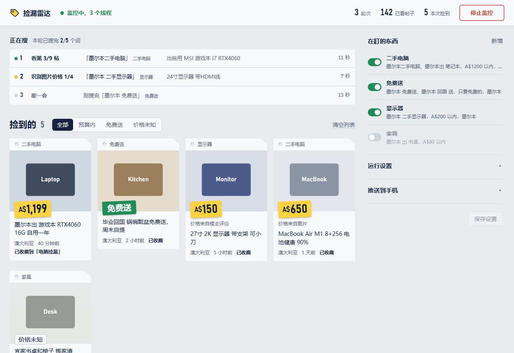

# 捡漏雷达

**帮你在小红书上蹲二手和免费送的浏览器扩展。** 写好想要的东西、所在城市和预算，它会在后台一直搜。碰到价格合适、还没卖掉的帖子就推送到手机，并顺手收藏好，你只管联系卖家。

为在海外的留学生收二手而做：认得 `💰 2199`、`1199🔪`、`A$1,300`、`3K5` 这类写法，会自动换算成你的预算币种。

[](https://github.com/jiongjiong123441/xhs-hunter/actions/workflows/build.yml)
[下载最新版](https://github.com/jiongjiong123441/xhs-hunter/releases/download/latest/xhs-hunter-latest.zip)



## 能做什么

- **多个搜索任务一起盯**：每个任务有自己的搜索词、地区、预算和物品关键词，比如「二手电脑，A$1000 以内」「墨尔本免费送」。
- **多线程**：几个后台标签页同时搜，控制台上能实时看到每个线程在搜哪个词、在看哪条帖子。
- **只推真正在卖的**：会排除提问帖、测评、避雷、聊天帖，也会排除标题、正文、评论或图片里写了 `已出 / hold / sold` 的帖子。
- **价格认得准**：价格依次从正文、楼主自己的评论、图片（离线 OCR）里找。原价、配置参数（16G、2.5K 屏、240Hz）都不会被当成价格。
- **推送到手机**：支持 ntfy、Bark、Telegram、Server酱（微信）。
- **自动收藏**：可以放进你指定的专辑，回头在手机 App 里直接看。
- **省请求**：搜索结果卡片上就能判断的帖子（太旧、不相干、超预算）不会点开。

## 安装

1. [下载 `xhs-hunter-latest.zip`](https://github.com/jiongjiong123441/xhs-hunter/releases/download/latest/xhs-hunter-latest.zip)，解压。
2. Chrome 打开 `chrome://extensions`（Edge 是 `edge://extensions`），打开**开发者模式**。
3. 点**加载已解压的扩展程序**，选择解压出来的 `xhs-hunter` 文件夹。
4. 在同一个浏览器里登录小红书网页版。**建议用小号。**
5. 点工具栏上的扩展图标，打开控制台。

**更新**：下载新的 zip，解压覆盖原来的文件夹，再在扩展页点「重新加载」。设置和捡到的记录都存在浏览器里，不会丢。

> 为什么不是 `.crx` 或应用商店？Chrome 在 Windows 上不允许安装商店以外的 `.crx`，所以用「加载已解压的扩展程序」。

## 上手

1. **先设币种**（在「运行设置」里）。在澳洲就把「预算用什么币」「没写币种的数字按」「"$"和"刀"指」都选 AUD；在英国选 GBP。不然 `💰 450` 会被当成人民币。
2. **写任务**（右边「在盯的东西」→ 新增）：

   | 字段 | 例子 | 说明 |
   |---|---|---|
   | 搜索词 | `墨尔本二手电脑, 墨尔本出 笔记本` | 每个词单独搜一次。带上城市名，搜出来的更准 |
   | 地区 | `墨尔本, Melbourne` | 匹配帖子的 IP 属地或正文。海外 IP 属地通常只显示国家，所以写城市名更准 |
   | 最低价 / 最高价 | `0` / `1000` | 按预算币种算，其他币种会按汇率换算 |
   | 物品关键词 | `电脑, 笔记本, 游戏本, 主机, MacBook` | 帖子里要提到其中一个。留空则从搜索词里自动取，但最好补上同义词 |
   | 收藏到专辑 | `电脑捡漏` | 留空就用全局设置。专辑要先在小红书里建好 |
   | 免费送也算 | ✔ | 认得「免费送、白送、送有缘人、free」。「免费包邮」「买就送」不算 |

   只想捡免费的：最高价填 `0`，勾上「免费送也算」，搜索词写 `墨尔本 免费送, 墨尔本 回国 送`。
3. **填推送**（「推送到手机」）。海外最推荐 ntfy：手机装 ntfy，订阅一个别人猜不到的主题名，把同样的名字填进来，点「发一条测试推送」。
4. 点**开始监控**。控制台这个标签页就是程序本身，监控期间要一直开着。

## 它怎么判断一条帖子

```
搜索结果卡片 ──► 太旧？标题有排除词或已出？标题像提问或聊天？标题价格全超预算？
                     │ 是：记为已读，不点开
                     ▼ 否
点开帖子 ──────► 是不是在卖？（「墨尔本出」「出一台」「#出物」算，「出门」「出现」不算）
                 卖的是不是你要的？（物品关键词）
                 地区对不对？（IP 属地或正文）
                 有没有写 已出 / hold / sold？（含评论区）
                     ▼
找价格 ────────► 正文 → 楼主评论 → 图片 OCR（找到就停，前面的优先）
                     ▼
在预算内或免费送：推送 + 收藏    没写价格：只列在控制台，不推送    超预算：跳过
```

几个细节：

- 一条帖子里有明确标价（`💰`、`🔪`、`¥`、`A$`、「售价」「到手价」）时，只认这些，其他零散数字一律忽略。
- 「已出了吗？」「还没出」「hold不住」这类问句和否定说法不算已出。别人在评论里问「3k卖不卖」也不算价格。
- 图片上只认带价格符号的数字，型号和跑分截图不会被读成价格。
- 每条帖子只看一次。想让它重新检查所有帖子，点日志下面的「重置已读记录」。

## 风控与频率

小红书对频繁访问很敏感。默认设置已经算比较积极：2 个线程，每轮搜完歇约 6 分钟，每看一条帖子随机等 4 到 9 秒。

- 线程越多越快，但都是同一个账号在访问，越容易被要求验证。建议 2 到 3 个。
- 遇到登录或验证码时，所有线程会暂停，并弹出系统通知、推送到手机。你在那个标签页里手动完成验证后，程序自动继续。**程序不会去破解验证码。**
- 每轮结束、点停止、关掉控制台时，后台标签页会全部关掉。

## 常见问题

**日志里一直是「0 条结果」或「读取失败」**
小红书网页改版了，读取页面的代码需要更新（`engine.js` 里的 `pageScrapeSearch` 和 `pageScrapeDetail`）。欢迎提 issue，附上日志截图。

**价格认错了**
把帖子正文（或截图）和日志里那一行发到 issue。价格识别是规则匹配，每个新写法都可以加进 `test.js` 防止以后再错。

**收藏到专辑失败**
日志会写明卡在哪一步：没找到「添加到专辑」入口，或者专辑列表里没有这个名字。帖子此时仍在默认收藏里。先确认专辑已经建好、名字一字不差。

**Chrome 扩展页有 OCR 相关的警告**
OCR 组件（tesseract）会打印一些无害的提示，大部分已经过滤。剩下的不影响使用。

## 开发

```
manifest.json      扩展清单（Manifest V3）
background.js      点图标打开控制台；通知点击；关控制台时清理标签页
dashboard.*        控制台界面
engine.js          多线程搜索、卡片过滤、帖子判断、收藏、推送
price.js           价格 / 免费 / 已出 / 发布时间 / 不相干 的识别规则
test.js            识别规则的测试：node test.js
lib/               离线 OCR（tesseract.js 5.1.1 与中英文模型）
scripts/pack.sh    检查 + 测试 + 打包成 zip，产物在 dist/
```

改完代码在扩展页点「重新加载」就能用，不需要编译。

每次推送到 `main`，GitHub Actions 会跑语法检查和 `node test.js`，通过后打包并刷新 [最新版](https://github.com/jiongjiong123441/xhs-hunter/releases/tag/latest)。推送 `v1.2.3` 这样的标签会另外发一个正式版本。

## 声明

这是个人学习和自用的工具，跟小红书官方没有任何关系。它只是在你自己登录的浏览器里，用正常的速度替你翻页面。请遵守小红书的用户协议，不要调高频率去大量抓取，也不要把抓到的内容用于商业用途。因为使用本工具造成的账号限制等后果，需要使用者自己承担。

## 许可

本项目代码以 [MIT 许可证](LICENSE) 发布：可以自由使用、修改和再发布，保留版权声明即可。

## 第三方

`lib/` 里是 [tesseract.js](https://github.com/naptha/tesseract.js) 5.1.1、tesseract.js-core 和 tessdata 中英文模型，均为 Apache-2.0 许可，原样附带（`lib/worker-quiet.js` 除外，那是本项目的包装）。
